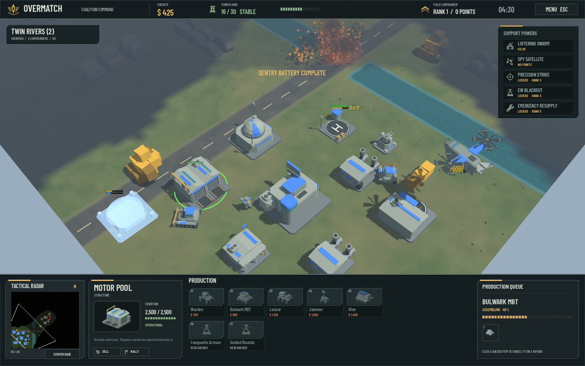
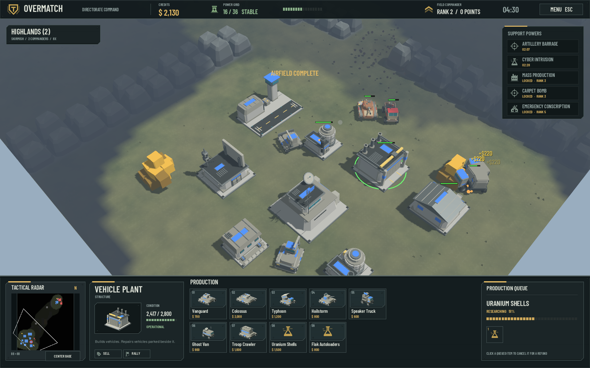
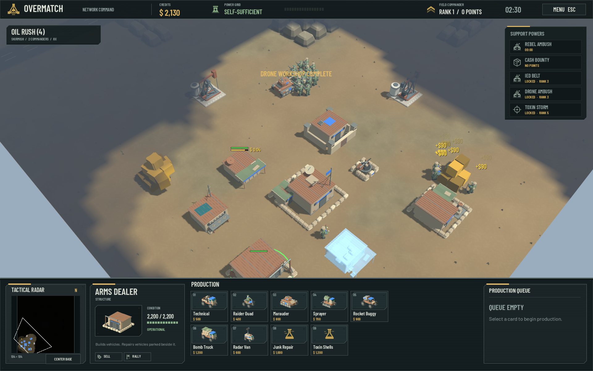
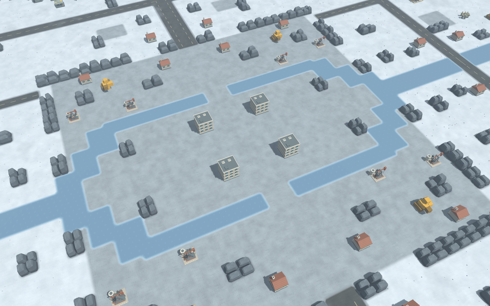

# Overmatch

**An open-source real-time strategy game in the spirit of Command & Conquer: Generals – Zero Hour, set in the 2030s.**

[](docs/screenshots/coalition-command.png)

*Coalition base on Twin Rivers, with a Motor Pool assembling a Bulwark MBT and the live command HUD.*

Generals gave us build-anywhere bases, supply-pile economies, three brutally asymmetric factions, generals' powers and superweapons on a countdown. Then the sequel was cancelled. Overmatch is the sequel we're building ourselves: from scratch, fully open, for macOS and Windows.

The world has moved on since 2003. Overmatch's battlefield is today's: cheap FPV drones and loitering munitions, electronic warfare and GPS denial, cyber attacks on infrastructure, hypersonic strikes, private military companies, and the endless tension between cheap mass and exquisite tech.

## Factions

| | Archetype | Identity |
|---|---|---|
| **Coalition** | high-tech, air power, drones | Precision, expensive, drone swarms, EW, orbital kinetic strike |
| **Directorate** | mass, armour, artillery | Hordes, heavy tanks, rocket artillery, cyber, propaganda, nukes |
| **Network** | insurgent, hybrid warfare | Cheap, stealth, tunnels, IEDs, FPV drones, salvage, no power needed |

## Screenshots

Fresh captures from AI skirmishes in the current game. The full roster now has detailed models for **42 units, 30 faction buildings and four neutral props**: composite armour and aircraft for the Coalition, heavy industrial machinery for the Directorate, patched steel and field equipment for the Network. Layered terrain, animated water, marked roads and rock formations sit beneath the live command HUD.

| Directorate | Network |
|---|---|
| [](docs/screenshots/directorate-base.png) | [](docs/screenshots/network-base.png) |
| Directorate industry on Highlands, with vehicle production and upgrades. | Improvised buildings and converted vehicles. |

[](docs/screenshots/twilight-frost.png)

*Twilight Frost: a frozen river battlefield for eight commanders. This terrain overview uses the in-game camera with the HUD and fog of war hidden to show the landscape.*

Click any screenshot for its full resolution. [Capture details](docs/screenshots/README.md).

See the [full roster and battlefield art gallery](artifacts/art-pass/README.md) for individual models and terrain comparisons.

## Status

**Pre-alpha, with playable single-player skirmishes.** The current build includes:

- **Three complete faction trees and seven maps.** Twilight Frost is a 192 × 192 battlefield for up to eight commanders: you and seven AI opponents. Choose from four AI difficulty tiers.
- **Build-anywhere bases and a working economy.** Harvest supplies, capture oil derricks, produce units, research upgrades and repair your forces. Builders repair buildings; barracks heal infantry, factories repair vehicles and airfields repair aircraft.
- **Faction tactics and escalation.** Garrisons, transports, tunnels, stealth and detection, veterancy, salvage, generals' promotions and powers, superweapons and battlefield hazards.
- **A complete skirmish loop.** Movement, combat, fog of war, victory and defeat, with a live command HUD, minimap, control groups and guard orders.
- **Sound and settings.** Synthesised effects, radio voices, an announcer, music and battle-damage effects; configurable display, interface scale, graphics, audio and camera controls.

M0–M5 are complete. The roster and terrain art pass, repairs, settings and Twilight Frost have followed M5. **M6—packaged releases and contributor/modding documentation—is next.** See [docs/design](docs/design/) for the design and [docs/roadmap.md](docs/roadmap.md) for where this is going.

## Building from source

Requirements:

- [Godot 4.7.2 (.NET build)](https://godotengine.org/download)
- [.NET SDK 10](https://dotnet.microsoft.com/download) (tests and tools target .NET 10; the game targets .NET 8)
- [Blender 5.2 LTS](https://www.blender.org/download/lts/) (only to regenerate models)

```bash
dotnet test sim.tests                     # simulation unit tests
dotnet build game/Overmatch.csproj        # compile the game assembly
godot-mono --path game                    # run the game (godot-mono is the Homebrew cask name; use your Godot .NET binary)
bash tools/art/build_roster.sh            # regenerate all models with Blender (optional)
godot-mono --headless --path game --export-release macOS   # export (see game/export_presets.cfg)
```

Visual smoke test: `godot-mono --path game -- --smoke=/tmp/out.png --speed=8 --ai=medium` skips the menu, runs a Medium AI for six game minutes at 8x, screenshots its base and quits. `--ai=<difficulty>` alone starts a match straight away.

## Controls

| | |
|---|---|
| Left-drag / click | select; Shift adds; double-click selects every unit of that type on screen |
| Right-click | move, attack, enter a building or transport, capture a tech building, harvest, help build, repair a damaged building with a builder, send aircraft home to an airfield, set a rally point |
| A then click | attack-move |
| G then click | guard an area: engage intruders, then return to post |
| S / X | stop / scatter |
| R / V | aircraft return to base / unload passengers |
| Q / W / E / I | select all combat units / all aircraft / matching units (E twice: everywhere) / next idle builder |
| Ctrl+0–9 / 0–9 | set / recall a control group; double-tap to jump; Shift adds it to the selection; Alt only looks. Units wear their group number |
| H | jump to headquarters |
| Space | jump to the last alert |
| Click anything not yours | inspect it |
| Arrow keys, screen edges, middle-drag | pan; [ and ] rotate; wheel, two-finger scroll or +/- zoom |
| Minimap | left-click to look, right-click to send the selection |
| M / F9 | music on/off / hide the interface; Esc pauses |

Settings (title screen or pause menu): window mode and size, interface size, 3D resolution, anti-aliasing, V-sync, five volume sliders, edge scrolling, scroll speed, group tags, and the full key list. Saved to `user://settings.cfg`.

Hover any build, unit, upgrade or power button to read what it costs, what it needs, and what it can attack (ground, air or both).

## Tools

```bash
dotnet run --project tools/harness -c Release -- --seeds 3          # AI-vs-AI balance matrix
dotnet run --project tools/harness -c Release -- --timeline coalition,network,plain
python3 tools/maps/build_maps.py        # regenerate the symmetric maps
python3 tools/audio/build_sfx.py        # synthesise sound effects (pure Python)
python3 tools/audio/build_voices.py     # voice lines; needs `brew install espeak-ng`
python3 tools/audio/build_music.py      # the ambient loop
```

## Repository layout

```
docs/design/       game design: pillars, factions, systems, data schema
sim/               Overmatch.Sim – engine-independent simulation (C#)
sim.tests/         xUnit tests for the sim
game/              Godot 4.7 project (presentation, input, UI)
tools/blender/     Python scripts that generate every model as glTF
tools/harness/     headless AI-vs-AI match runner
tools/maps/        map generator
tools/audio/       sound, voice and music generators
```

## Licence

Code is licensed under the [GNU GPL v3](LICENSE). Original art, audio and data are licensed under [CC BY 4.0](LICENSE-ASSETS). Third-party assets are listed with their licences in [CREDITS.md](CREDITS.md).

Overmatch is a fan project. It is not affiliated with or endorsed by Electronic Arts. Command & Conquer and Generals are trademarks of Electronic Arts Inc.
